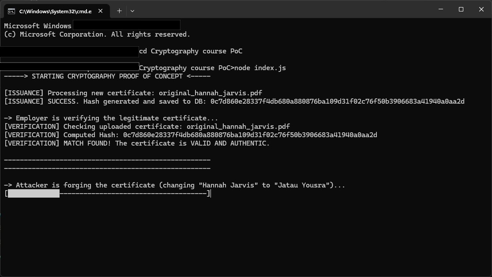

# Certificate Hash Verification System (Proof of Concept)

This repository contains a Proof of Concept (PoC) developed as part of a university examination project in Cryptography. It explores a privacy-preserving mechanism for issuing and verifying digital certificates using cryptographic hashing.



---

## 1. Scenario & Academic Context

An examination authority issues personal qualification certificates to candidates upon passing an exam. The organisation operates under two primary requirements:

1. **Privacy by Design & Data Minimisation:** The company wishes to delete all candidate personal data and examination results as soon as possible after issuing the certificate.
2. **Third-Party Verification:** Candidates must be able to present their certificate to third parties (e.g. prospective employers, clients, or academic institutions), who must be able to independently verify its authenticity via a web service without needing access to the candidate's historic records.

To satisfy both criteria, the proposed architecture stores **only a salted cryptographic hash** of the issued certificate. Because cryptographic hash functions are one-way (pre-image resistant), no sensitive candidate data can be recovered from the stored digests, yet any future presentation of the untouched certificate can be verified with mathematical certainty.

---

## 2. How the Proof of Concept Works

The demonstration script ([`index.js`]) simulates the full life cycle of certificate issuance, verification, and adversarial tampering:

```
[Issuance]      original.pdf + Secret Salt ──> SHA-256 ──> database.txt
[Verification]  uploaded.pdf + Secret Salt ──> SHA-256 ──> Lookup in database.txt (MATCH -> VALID)
[Forgery]       original.pdf ──[ Stream Tampering & Font Injection ]──> forged.pdf
[Tamper Check]  forged.pdf   + Secret Salt ──> SHA-256 ──> Lookup in database.txt (NO MATCH -> FORGED)
```

1. **Issuance:**
   - Computes a salted SHA-256 digest (`crypto.createHash("sha256")`) of [`original_hannah_jarvis.pdf`].
   - Appends the resulting digest to a persistent ledger (`database.txt`).
2. **Authentic Verification:**
   - Simulates an employer submitting the authentic document.
   - Recomputes the digest and matches it against the database, confirming the certificate is **valid and authentic**.
3. **Simulated Adversary (PDF Stream Tampering):**
   - Simulates an attacker attempting to forge the credential for another identity (*"Jatau Yousra"* instead of *"Hannah Jarvis"*).
   - Decompresses the raw PDF content stream using `pako` (FlateDecode/zlib).
   - Neutralises the original kerning text operator `[(Hannah )17(Jarvis)] TJ` to preserve the graphics state machine without leaving visual artefacts.
   - Injects a standard font (`Helvetica-Bold`) to overcome font-subset limitations and renders the new name using exact typographic, spatial, and chromatic coordinates.
   - Re-serialises the modified document as `forged_jatau_yousra.pdf`.
4. **Tamper-Evident Verification Failure:**
   - Verifies the forged document. Because even a single altered byte produces an unpredictable, vastly divergent digest (avalanche effect), the lookup fails, correctly identifying the certificate as **invalid or forged**.

---

## 3. Getting Started

### Prerequisites

- [Node.js](https://nodejs.org/) (version 16 or newer recommended)
- `npm`

### Installation

Clone the repository and install the required dependencies:

```bash
npm install
```

### Running the Demonstration

Execute the demonstration script:

```bash
node index.js
```

---

## 4. Repository Structure

```text
.
├── index.js                     # Main demonstration script (issuance, verification, forgery)
├── original_hannah_jarvis.pdf   # Authentic sample certificate
├── package.json                 # Project dependencies (pdf-lib, pako)
├── package-lock.json
├── .gitignore
└── README.md
```

---

## 5. Scope & Limitations (System Rigidity)

> [!NOTE]
> This repository is intended strictly as an academic **Proof of Concept (PoC)** to accompany a written case study report and demonstrate cryptographic principles in practice.

While the script successfully proves that cryptographic hashing guarantees integrity and pre-image resistance for digital credentials, the implementation exhibits deliberate **rigidity**:

- **File & Template Coupling:** The PDF parsing and manipulation routines are hard-coded specifically for [`original_hannah_jarvis.pdf`]. The kerning regular expressions, exact layout coordinates (`x: 294.94, y: 337.06`), font size (`55pt`), and colour values (`rgb(0, 0.42, 0.839)`) apply solely to this individual document.
- **Lack of Modularity:** The script does not offer generic abstractions or modular parsers for differing document structures, varied font encodings, or multiple certificate templates.

Within the scope of the case study, however, this targeted implementation provides an unambiguous demonstration of how content tampering irreparably disrupts cryptographic digests.
